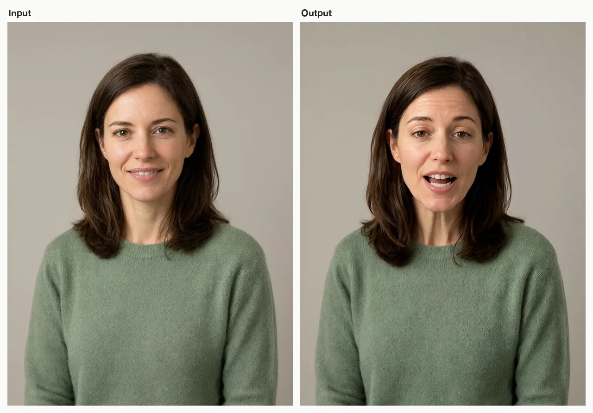

# Talking Avatar Video Skill

English | [简体中文](./README.zh-CN.md)

Turn one portrait and a short script into a talking avatar video, from inside Claude Code, Cursor, Codex, Windsurf, Cline, or OpenClaw.

> [!IMPORTANT]
> Rendering needs a [Beatra](https://beatra.ai) account and uses credits. The skill itself is free to install.

| Question | Answer |
| --- | --- |
| **What it does** | Turn one portrait and a short script or speech track into a directed talking-avatar video for explainers, announcements, lessons, and product messages. |
| **Models** | MiniMax Speech 2.8 HD, MiniMax Speech 2.8 Turbo, Wan 2.7, Wan 3.0 Video, MiniMax H3, Seedance 2.0 Mini, HappyHorse 1.1, Seedance 2.0 Fast, Seedance 2.0, Wan 3.0 Video Prime, Seedance 2.5 |
| **Requirements** | Python 3.10+ and an agent that loads `SKILL.md` |
| **Cost** | Free to install. Each render uses credits on your Beatra account, and paid steps run only when you ask for that exact render or approve its card. |
| **Works with** | Claude Code, Cursor, Codex, Windsurf, Cline, OpenClaw |

<p align="center"></p>

*A fictional presenter portrait (left) and a frame from the talking-avatar clip it became (right), driven by a short synthesized English line. AI-generated with Beatra.*

| Skill | Entry point | Version |
| --- | --- | --- |
| [`talking-avatar-video`](skills/talking-avatar-video) | [SKILL.md](skills/talking-avatar-video/SKILL.md) | 0.3.0 |

This repository is published automatically from [beatra-ai/beatra-skills](https://github.com/beatra-ai/beatra-skills/tree/main/skills/talking-avatar-video). Report issues there.

## Install

With the [`skills`](https://skills.sh) CLI:

```bash
npx skills add beatra-ai/talking-avatar-video-skill
```

With the GitHub CLI:

```bash
gh skill install beatra-ai/talking-avatar-video-skill talking-avatar-video
```

Or clone this repository and copy `skills/talking-avatar-video` into `~/.claude/skills/` for Claude Code,
`~/.cursor/skills/` for Cursor, `~/.agents/skills/` for Codex, `~/.codeium/windsurf/skills/` for Windsurf,
`~/.cline/skills/` for Cline, or `~/.openclaw/skills/` for OpenClaw.

Or paste this into your agent:

```text
Install the talking-avatar-video skill from https://github.com/beatra-ai/talking-avatar-video-skill (folder skills/talking-avatar-video), then follow its SKILL.md to connect my Beatra account.
```

## Examples

<p align="center"></p>

[▶ Watch the full video (MP4)](assets/full.mp4)

*Full talking-avatar clip with voice: a fictional product educator says "Hi! In thirty seconds, I'll show you how our new planner app saves your mornings." AI-generated with Beatra.*

Prompt:

```text
A friendly presenter speaks directly to camera with a warm, natural delivery: steady eye line into the lens, restrained friendly expression, subtle natural head movement and occasional blinks, relaxed shoulders. Locked-off stable camera, plain studio background stays unchanged, same face, hair and green sweater throughout.
```

## Technical Specifications & Output Limits

As of 2026-10-18. Live list: https://docs.beatra.ai/en/docs/models

- **Uploads** — up to 100 MB per file; the per-model input limits below also apply
- **Text to speech** — 2 models (MiniMax Speech 2.8 HD, MiniMax Speech 2.8 Turbo); FLAC, MP3, OPUS, PCM, WAV; 40 languages; sample rates 8, 16, 22.05, 24, 32, 44.1 kHz; up to 50000 characters per request
  - Languages (ISO 639 codes): zh, yue, en, es, fr, ru, de, pt, ar, it, ja, ko, id, vi, tr, nl, uk, th, pl, ro, el, cs, fi, hi, bg, da, he, ms, fa, sk, sv, hr, fil, hu, no, sl, ca, nn, ta, af
- **Image to video** — 9 models (Wan 2.7, Wan 3.0 Video, MiniMax H3, Seedance 2.0 Mini, HappyHorse 1.1, Seedance 2.0 Fast, Seedance 2.0, Wan 3.0 Video Prime, Seedance 2.5); 480p to 4K; 2–30 s; aspect ratios 16:9, 1:1, 21:9, 3:4, 4:3, 9:16; MOV, MP4
  - 4K: Seedance 2.0, up to 15 s
  - 30 s: Wan 3.0 Video, Wan 3.0 Video Prime, Seedance 2.5, up to 1080p
  - Native audio: Wan 2.7, MiniMax H3

## Why use Beatra instead of calling model APIs directly

- **One account for every model this skill uses** — Text to speech 2; Image to video 9 (MiniMax Speech 2.8 HD, MiniMax Speech 2.8 Turbo, Wan 2.7, Wan 3.0 Video, MiniMax H3, Seedance 2.0 Mini, HappyHorse 1.1, Seedance 2.0 Fast, Seedance 2.0, Wan 3.0 Video Prime, Seedance 2.5) (as of 2026-10-18), behind one Beatra sign-in; no keys from individual model providers to manage.
- **You decide what gets paid for** — Paid renders run only when you ask for that exact render or approve its card, which shows the live credit estimate.
- **Direction before rendering** — the skill plans, directs, and reviews the work, then renders it on Beatra.
- **Files you can verify** — every file under `skills/` matches the release archive on cdn.beatra.ai byte for byte, checked by SHA-256 before each push.
- **Updates you control** — no self-updater; update with the tool you installed it with.
- **Runs in your agent** — Claude Code, Cursor, Codex, Windsurf, Cline, OpenClaw.

## What you get

- **Prepare the speech** — Use a supplied speech track or turn a short script into reviewable narration before the video stage.
- **Direct a credible shot** — Keep expression, head movement, camera, and background restrained, then review identity and mouth timing honestly.

## Use cases

- **Product explainers** — Present a short feature, offer, or launch message without a new camera shoot.
- **Training and lessons** — Deliver a compact onboarding point, course introduction, or internal update.
- **Announcements and social** — Turn a prepared message into a human-facing announcement or talking-head post.

## FAQ

### What do I need to start?

One portrait and either a supplied speech track or a short script plus a voice choice.

### Can I use my own recorded audio?

Yes, when its type and length fit a currently supported video route.

### How are lip sync and presenter consistency reviewed?

The speech drives facial motion, and the finished clip is reviewed for mouth timing, identity, voice clarity, and motion stability before choosing the most useful adjustment.

## Updates and security

Since the 2026-10 release, this skill contains no self-updater: it runs only the
files you installed and never replaces them on its own. Update it with the tool
you installed it with — `npx skills update talking-avatar-video` or `gh skill update talking-avatar-video`.
Details: `references/updates-and-security.md` inside the skill.

## License

[MIT-0](LICENSE) — free to use, modify, and redistribute, including
commercially. No attribution required. Same terms as these skills carry on
ClawHub.

## Links

- Website — https://beatra.ai
- Docs — https://docs.beatra.ai
- Console — https://console.beatra.ai
- For AI agents — https://beatra.ai/llms.txt (index) · https://beatra.ai/llms-full.txt (every skill in one file)
